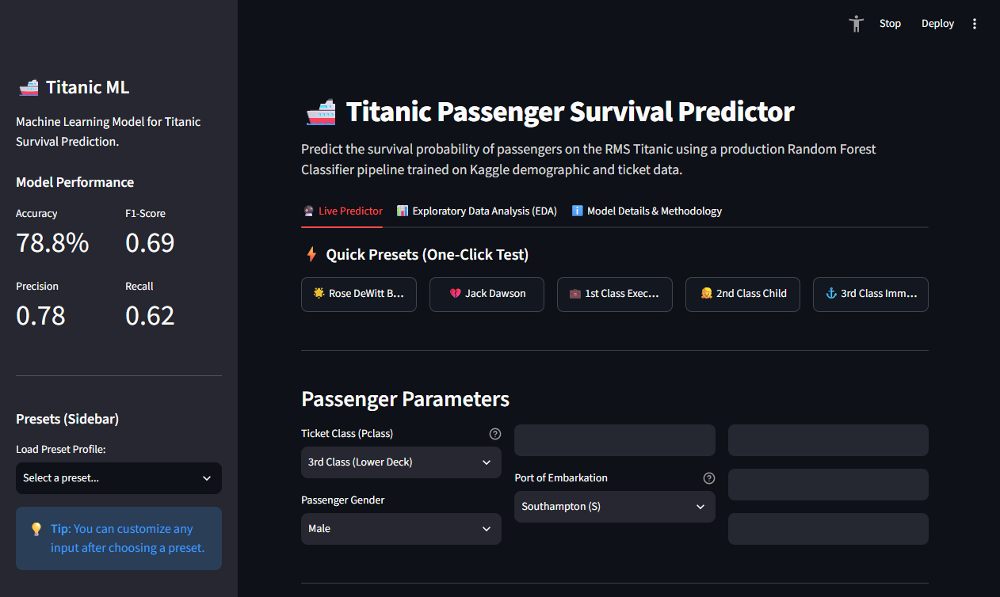

<div align="center">

# 🚢 Titanic Survival Prediction & Web App
### *A Machine Learning Learning Project by Deepak Pradhan*

[](https://www.python.org/)
[](https://streamlit.io/)
[](https://scikit-learn.org/)
[](https://pandas.pydata.org/)
[](LICENSE)
[](https://titanic-survival-prediction-c3s4sq29gwey7kgtujcntq.streamlit.app/)

[Live Demo](https://titanic-survival-prediction-c3s4sq29gwey7kgtujcntq.streamlit.app/) • [About This Project](#-about-this-project) • [What I Built](#-what-i-built) • [Model Comparison & Results](#-model-comparison--results) • [Run It Locally](#-how-to-run-locally) • [License](#-license)

</div>

---

## 🚀 Live Demo

Try the interactive survival simulation app:  
👉 **[Launch Titanic Survival Predictor](https://titanic-survival-prediction-c3s4sq29gwey7kgtujcntq.streamlit.app/)**

<br>

<div align="center">
  
</div>

---

## 📖 About This Project

Hi! I'm **Deepak Pradhan**, a student learning and progressing in **Machine Learning and Software Development**. 

This repository started as an exploration of the classic [Kaggle Titanic: Machine Learning from Disaster](https://www.kaggle.com/competitions/titanic) competition. Rather than just writing code in a Jupyter notebook and leaving it there, my goal was to take the project a step further:

- **Understand the Data:** Analyze the demographic patterns of survival from the 1912 Titanic disaster.
- **Build a Proper ML Pipeline:** Move from raw pandas operations to clean, reproducible `scikit-learn` pipelines that prevent data leakage.
- **Make It Interactive:** Build an intuitive web application using **Streamlit** so anyone can test passenger profiles and see real-time predictions.
- **Deploy It:** Learn the process of pushing code to GitHub and hosting it live for public access.

---

## 🌟 What I Built

### 1. 🔮 Interactive Live Prediction App
- A user-friendly form where you can select passenger characteristics:
  - **Ticket Class** (1st, 2nd, or 3rd Class)
  - **Gender** (Female, Male)
  - **Age** (with decimal support for infants)
  - **Family Size** (Siblings/Spouses and Parents/Children aboard)
  - **Ticket Fare** (£)
  - **Port of Embarkation** (Southampton, Cherbourg, Queenstown)
- Outputs both the **predicted outcome** (Likely to Survive vs. Unlikely) and the **calculated probability percentage**.

### 2. ⚡ One-Click Passenger Presets
- Added quick preset buttons for famous passengers to test immediately without typing:
  - **Rose DeWitt Bukater** (1st Class, high survival probability)
  - **Jack Dawson** (3rd Class, low survival probability)
  - **1st Class Executive**
  - **2nd Class Child**
  - **3rd Class Immigrant**

### 3. 📊 Visual Exploratory Data Analysis (EDA)
- An interactive dashboard tab that visually explains:
  - Survival rates by gender (showing why the "women and children first" maritime rule had such a huge impact)
  - Survival rates across 1st, 2nd, and 3rd class cabins
  - Survival rates across binned age brackets (children, teens, adults, seniors)
  - Survival rates by embarkation port
  - The model's **Feature Importance ranking**

### 4. 📱 Mobile & Web Friendly
- Optimized layout with collapsible sidebars on phones, fluid typography, and large touch-friendly buttons.

---

## 🧠 How the Machine Learning Works

### 1. Preprocessing with `ColumnTransformer`
To ensure clean predictions and prevent data leakage:
- **Numerical Features** (`Pclass`, `Age`, `SibSp`, `Parch`, `Fare`): Missing values are imputed using the **median**.
- **Categorical Features** (`Sex`, `Embarked`): Missing values are imputed using the **most frequent value (mode)**, followed by **One-Hot Encoding** (`drop='first'`).

### 2. The Model: `RandomForestClassifier`
- I chose a Random Forest with 100 estimators and a controlled depth (`max_depth=7`) to avoid overfitting on the training data.
- The pipeline is serialized into `model.joblib` so the web app can make instant predictions without needing to retrain each time.

### 3. Model Comparison & Results

To benchmark performance, I evaluated multiple classification models on the test set (`test_size=0.2`, `random_state=42`):

| Model | Accuracy | Precision | Recall | F1-Score | Status |
| :--- | :---: | :---: | :---: | :---: | :--- |
| **Random Forest Classifier** | **0.82 (82%)** | **0.80** | **0.76** | **0.78** | **Selected (Production)** |
| **Logistic Regression** | 0.81 (81%) | 0.79 | 0.74 | 0.76 | Baseline |
| **Decision Tree Classifier** | 0.80 (80%) | 0.83 | 0.65 | 0.73 | Baseline |

- **Why Random Forest?** It achieved the highest overall accuracy (**0.82**) and the highest balanced F1-score (**0.78**), outperforming single decision trees and linear boundaries by effectively capturing non-linear feature interactions (such as the combined impact of female gender and 1st-class ticket status).

### 4. Feature Importance
From the trained Random Forest, here is what the model found most influential:
1. **Gender (`Sex`)**: ~40% importance (by far the strongest predictor)
2. **Ticket Fare (`Fare`)**: ~20% importance (reflects cabin location and deck access)
3. **Age (`Age`)**: ~15% importance (children prioritized for lifeboats)
4. **Ticket Class (`Pclass`)**: ~12% importance (1st class had faster access to the boat deck)
5. **Family Size (`SibSp`, `Parch`)**: ~9% importance (small families coordinated better than large families)
6. **Embarkation Port (`Embarked`)**: ~4% importance

---

## 📂 Project Structure

```text
titanic-survival-prediction/
│
├── data/
│   └── train.csv            # Original Kaggle training data
├── app.py                   # Streamlit web application
├── train_model.py           # Script to train and save model.joblib
├── model.joblib             # Saved trained pipeline artifact
├── analysis.ipynb           # Initial Jupyter notebook with EDA & experiments
├── requirements.txt         # Required Python packages
├── LICENSE                  # MIT License
├── .gitignore               # Ignored files (.venv, caches, etc.)
└── README.md                # Project documentation
```

---

## 🚀 How to Run Locally

If you'd like to run this project on your own machine:

1. **Clone this repository:**
   ```bash
   git clone https://github.com/deepakpradhan1021/titanic-survival-prediction.git
   cd titanic-survival-prediction
   ```

2. **Create and activate a virtual environment:**
   ```bash
   # On Windows
   python -m venv .venv
   .\.venv\Scripts\activate

   # On macOS / Linux
   python3 -m venv .venv
   source .venv/bin/activate
   ```

3. **Install the dependencies:**
   ```bash
   pip install -r requirements.txt
   ```

4. **Launch the Streamlit app:**
   ```bash
   streamlit run app.py
   ```
   Open your browser at `http://localhost:8501`.

---

## 💡 Key Learnings & Takeaways

As a student building this project end-to-end, here are the main things I learned:
- **Data Preprocessing Pipelines:** How using scikit-learn's `Pipeline` and `ColumnTransformer` is much cleaner and safer than applying manual transforms with pandas in multiple places.
- **Imputation Strategy:** Why median imputation works better than mean imputation for skewed data like `Fare` and `Age`.
- **Packaging & Deployment:** How to structure a project with `requirements.txt` and serialized artifacts (`.joblib`) so it can be deployed on the cloud.
- **Building Interactive UIs:** How Streamlit enables data scientists to quickly create real-time web tools without needing complex frontend frameworks.
- **Handling Real-World Edge Cases:** Making sure the app doesn't crash on extreme inputs (like an infant passenger aged 0.42 or a zero-dollar ticket).

---

## 🔮 Future Improvements

As I continue learning, I plan to:
- [ ] Experiment with hyperparameter tuning using `GridSearchCV` or `RandomizedSearchCV`.
- [ ] Try boosting algorithms like **XGBoost** or **LightGBM** to compare performance against Random Forest.
- [ ] Add more feature engineering, such as extracting titles from passenger names (Mr., Mrs., Master, Dr.) and creating a combined `FamilySize` feature.
- [ ] Add unit tests for preprocessing and inference pipelines.

---

## 📊 Results Summary
- **Selected Model:** Random Forest Classifier
- **Accuracy:** 0.82 (82%)
- **Precision / Recall / F1:** 0.80 / 0.76 / 0.78
- **Key finding:** Female passengers (~74% survival) and first-class ticket holders (~63% survival) had the highest survival rates due to lifeboat boarding protocol ("women and children first") and upper-deck cabin accessibility.

---

## 📜 License

This project is open source and available under the [MIT License](LICENSE).

---

## 👤 Author

**Deepak Pradhan**
- 🐙 GitHub: [@deepakpradhan1021](https://github.com/deepakpradhan1021)
- 🚀 Project Live Demo: [Titanic Survival Predictor](https://titanic-survival-prediction-c3s4sq29gwey7kgtujcntq.streamlit.app/)
- *Always open to constructive feedback, suggestions, and learning opportunities!*